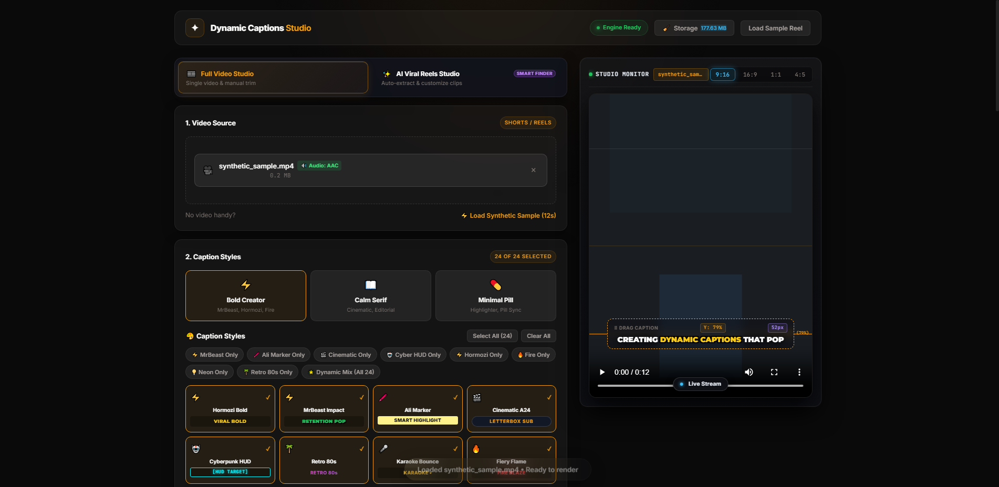
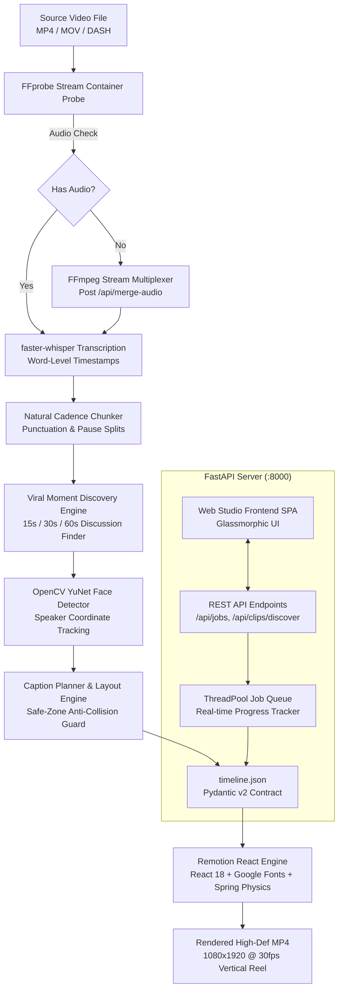
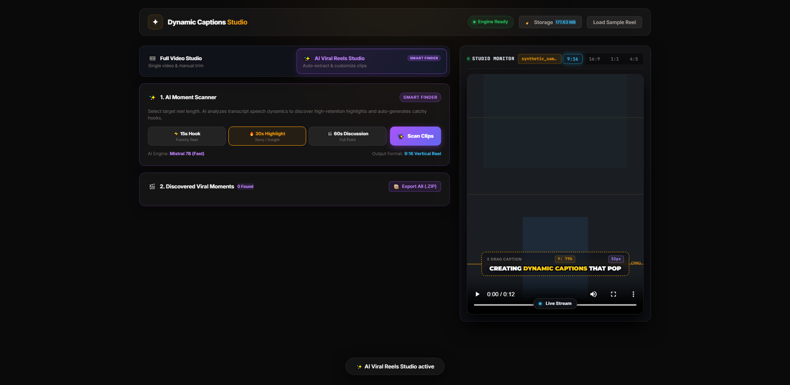

# 🎬 ViralForge AI — Dynamic Captions & Viral Reels Studio

<div align="center">

> **Transform long videos and podcasts into high-retention, viral short-form clips (9:16 Reels, Shorts, TikTok) with automated viral moment discovery, AI face-tracking reframing, and 24+ dynamic kinetic caption styles.**

[](https://www.python.org/)
[](https://fastapi.tiangolo.com/)
[](https://www.remotion.dev/)
[](https://opencv.org/)
[](LICENSE)

[Features](#-key-features) • [Architecture](#-architecture) • [Quickstart](#-quickstart-guide) • [Web Studio](#-creator-web-studio) • [Styles Library](#-24-signature-caption-styles) • [CLI Usage](#-command-line-interface-cli) • [API](#-rest-api-reference)

<br/>



</div>

---

## 🌟 Overview

**ViralForge AI** is an all-in-one studio designed for creators, editors, and podcast networks. It takes raw, unedited footage (horizontal 16:9 or vertical 9:16) and autonomously extracts the most engaging highlights, frames the active speakers using deep-learning face detection, and renders dynamic, animated captions inspired by top creators like **Ali Abdaal**, **Alex Hormozi**, and **MrBeast**.

Everything runs locally with **zero external dependencies required** (100% offline rule-based heuristic planner), with optional plug-and-play AI acceleration using **Mistral AI** (`open-mistral-7b`) or **Google Gemini** (`gemini-2.5-flash`).

---

## ✨ Key Features

### 🔍 1. AI Viral Moment Discovery (15s, 30s, 60s)
- **High-Impact Speech Detection**: Scans transcripts for breakthrough insights, counterintuitive lessons, high-stakes stories, and heated debates while filtering out mundane chatter.
- **Virality Scoring (7.0 - 10.0)**: Evaluates retention potential, opening hook strength, and cadence density.
- **Guaranteed Curated Output**: Ensures at least 10 high-value candidate clips for long podcasts, scaling up to 25 top moments without flooding the gallery.
- **Auto-Generated Social Media Posts**: Instantly produces viral hooks, descriptions, and hashtags tailored for TikTok, Instagram Reels, and YouTube Shorts.

### 🎯 2. Computer Vision Speaker Tracking & 9:16 Reframe Engine
- **YuNet Deep Learning Face Detector**: Integrated OpenCV neural network detects speaker coordinates across video frames.
- **Mathematical Viewport Centering**: Eliminates awkward edge crops with exact visible-overflow projection, keeping active speakers centered.
- **Multiple Video Layouts**:
  - **Active Speaker Solo Focus**: Dynamically cuts between speakers in a full 9:16 broadcast portrait.
  - **Podcast Split-Screen Stack**: Vertical split screen (dual-speaker or triple-speaker view).
  - **Ambient Frosted Blur (`blur_fit`)**: Sharp centered 16:9 frame layered over a dynamic, blurred 9:16 backdrop.

### 🎨 3. 24+ Signature Caption Styles
- **Creator Pool**: Hormozi Bold, Beast Impact, Highlighter Marker, Karaoke Bounce, Pill Word-by-Word, Neon Glow, Cyber HUD, Typewriter Terminal, Paper Cutout, Cinematic Minimal, Comic Bubble, Fire Burn, Glitch Kinetic, Gradient Outline, Retro Vaporwave, Quote Editorial, 3D Extruded Titles, Arched Letters, and more.
- **Ali Abdaal Editorial Pacing**: Smart multi-style sentence variety rotation that refreshes aesthetics every few sentences to maximize audience retention.
- **Active-Window Pagination Shield**: Strictly caps visible words on screen to 3–5 words at a time, completely preventing giant vertical text walls.

### 🚀 4. Viral Creator Boosters
- **Retention Progress Bar**: Sleek animated progress bar at the bottom or top of the reel.
- **Customizable Top Headline Hooks**: Eye-catching hook titles with configurable fade-out timers (5s, 10s, or persistent).
- **Kinetic Micro-Zooms**: Subtle, punchy camera zooms timed with speech emphasis.
- **Viral Sound Effects & Lo-Fi Audio Layer**: Built-in sound effects (whoosh, pop, ding) and background music tracks with automatic audio ducking.
- **3D Animated Stickers**: High-definition volumetric lighting assets (Microsoft Fluent 3D stickers: fire, rockets, lightbulbs, diamonds, etc.).
- **Automatic Multi-Speaker Diarization**: Distinct highlight colors for host and guest speakers.
- **Brand Watermark Overlay**: Customizable creator handle or brand logo overlay.

### 🎵 5. Robust Ingestion & DASH Audio Multiplexer
- **Silent / DASH Video Auto-Detection**: Detects YouTube DASH video streams that lack audio and prompts for an audio file.
- **Stream Multiplexing**: Merges video and audio in under 2 seconds without re-encoding video via FFmpeg stream mapping.

---

## 🏗️ Architecture



---

## 🚀 Quickstart Guide

### 1. Prerequisites
- **Python**: 3.10+ (Python 3.11 recommended)
- **Node.js**: 20.x+ & npm
- **FFmpeg & FFprobe**: Installed and available in system `PATH`
- **Git**: Installed

### 2. Installation

```bash
# Clone the repository
git clone https://github.com/AshadAbbasi212/ViralForge-AI.git
cd ViralForge-AI

# Create and activate Python virtual environment
# Windows (PowerShell):
python -m venv .venv
.venv\Scripts\Activate.ps1

# macOS / Linux:
python3 -m venv .venv
source .venv/bin/activate

# Install Python backend dependencies
pip install -r requirements.txt

# Install Remotion React dependencies
cd remotion
npm ci
cd ..
```

### 3. Environment Configuration (Optional for LLM)

```bash
cp .env.example .env
```

| Key | Description | Default |
| :--- | :--- | :--- |
| `LLM_PROVIDER` | `none` (offline heuristics), `mistral`, or `gemini` | `none` |
| `MISTRAL_API_KEY` | Mistral AI API key (for Mistral 7B viral discovery) | Optional |
| `GEMINI_API_KEY` | Google Gemini API key (for Gemini Flash planning) | Optional |
| `WHISPER_MODEL` | Faster-Whisper model size (`tiny`, `base`, `small`, `medium`) | `small` |

---

## 🌐 Creator Web Studio

Start the web studio with a single command:

```bash
uvicorn backend.api.app:app --host 127.0.0.1 --port 8000 --reload
```

Visit **[http://127.0.0.1:8000](http://127.0.0.1:8000)** in your browser.

### Studio Capabilities:
1. **Interactive Dual-Studio**: Switch between **Full Video Studio** (caption an entire talk) and **AI Viral Reels Studio** (extract bite-sized reels).
2. **Instant Previews**: Scrub and preview source videos directly in the embedded 9:16 Studio Monitor.
3. **Clip Customizer & Tweaker**: Fine-tune individual headlines, styles, font sizes, background audio, and boost options per reel before rendering.
4. **1-Click Batch Export**: Download all selected viral reels together in a structured `.zip` archive.
5. **Social Post Generator**: Click **"Copy Post"** to copy pre-formatted captions and hashtags ready for publishing.

<br/>



---

## 💻 Command-Line Interface (CLI)

Render videos directly from your terminal:

```bash
# Basic render (default Hormozi bold style)
python -m backend.cli samples/synthetic.mp4 -o out/final.mp4

# Fast draft preview (half resolution, 0s to 10s)
python -m backend.cli samples/synthetic.mp4 -o out/draft.mp4 --draft --start 0 --end 10

# Minimal pill word-by-word style
python -m backend.cli samples/synthetic.mp4 -o out/pill.mp4 --preset minimal_pill

# Specify custom spoken language
python -m backend.cli video.mp4 -o out/spanish.mp4 --language es
```

### CLI Options:

| Flag | Type | Description |
| :--- | :--- | :--- |
| `input` | `str` | Input video file path *(required)* |
| `-o`, `--output` | `str` | Output file destination (default: `out/final.mp4`) |
| `--preset` | `str` | Style preset (`bold_creator`, `calm_serif`, `minimal_pill`) |
| `--llm` | `str` | LLM planner provider (`none`, `mistral`, `gemini`) |
| `--draft` | `flag` | Fast preview at 540x960 resolution |
| `--start` / `--end` | `float` | Clip trim start and end times in seconds |
| `--concurrency` | `int` | Remotion parallel rendering worker count |

---

## 🎨 24 Signature Caption Styles

| Style ID | Font Family | Default Zone | Visual Aesthetic |
| :--- | :--- | :--- | :--- |
| `hormozi_bold` | Montserrat 900 | Lower | Bold uppercase words with vivid yellow/green punch highlights |
| `beast_impact` | Komika Axis | Center / Lower | Heavy comic drop-shadow action style |
| `pill_word` | Montserrat 800 | Lower | Clean high-contrast pill backdrop tracking spoken words |
| `highlighter_marker` | Caveat / Inter | Lower | Realistic animated marker stroke sweeping across key terms |
| `karaoke_bounce` | Montserrat 900 | Lower | Dynamic scaling bounce as each syllable is voiced |
| `title3d` | Montserrat 900 | Center | Volumetric extruded gradient title with glossy drop shadow |
| `cyber_hud` | Orbitron | Upper / Center | Sci-fi HUD brackets with neon digital telemetry |
| `neon_glow` | Montserrat 800 | Center | Vibrant neon cyan/magenta halo glow effect |
| `typewriter_terminal` | Fira Code | Lower | Retro green CRT monospace text with blinking cursor |
| `paper_cutout` | Impact | Center | Tactile jagged sticker cutout with subtle paper tilt |
| `cinematic_minimal` | Inter 500 | Lower | Elegant, understated white typography with subtle drop shadow |
| `comic_bubble` | Bangers | Upper | Pop-art speech balloon with halftone comic accents |
| `fire_burn` | Montserrat 900 | Center | Flaming gradient flare with ember particle animations |
| `glitch_kinetic` | Montserrat 900 | Center | Chromatic RGB split displacement with kinetic punch |
| `retro_vaporwave` | Outrun / Inter | Center | 80s synthwave neon magenta/cyan gradient aesthetic |
| `quote_editorial` | Playfair Display | Upper / Center | High-fashion editorial quote with elegant quotation marks |
| `numbered_point` | Montserrat 800 | Upper | Numbered badge step counter for multi-point tutorials |
| `handwritten` | Caveat 700 | Upper | Spontaneous human note with animated hand-drawn SVG arrow |
| `arc_letters` | Montserrat 900 | Center | Kinetic curved arc typography bending along an elastic path |

---

## 📡 REST API Reference

The backend exposes a fully typed OpenAPI / Swagger interface at `http://127.0.0.1:8000/docs`:

- `POST /api/probe`: Fast FFprobe metadata extraction (duration, resolution, audio streams).
- `POST /api/merge-audio`: Multiplexes an audio track into a silent video stream in <2 seconds.
- `POST /api/clips/discover`: Automatically extracts viral moments (15s, 30s, 60s) with virality scores.
- `POST /api/jobs`: Submits a video rendering job with custom styles, layouts, and boosters.
- `GET /api/jobs/{id}`: Polls live render progress and status.
- `POST /api/jobs/{id}/render-clip`: Renders an extracted viral clip into an independent MP4 reel.
- `POST /api/jobs/{id}/batch-render-clips`: Batch renders multiple selected reels in parallel.
- `GET /api/jobs/{id}/download-all-clips`: Bundles all completed reel MP4s into a single downloadable `.zip`.

---

## 🧪 Testing & Validation

The codebase includes an extensive automated test suite covering transcript chunking, layout safe zones, facial tracking, Remotion baseline rendering, and API contracts:

```bash
# Run the complete test suite
pytest -v
```

```
============================= 110 passed, 2 skipped in 11.96s =============================
```

---

## 📁 Project Structure

```
ViralForge-AI/
├── backend/
│   ├── api/             # FastAPI application, route handlers, and runner queue
│   ├── pipeline/        # Probe, Transcribe, Chunk, Viral Clips, YuNet Reframe, Layout, Render
│   ├── schemas/         # Pydantic v2 timeline data schemas & validation contracts
│   └── tests/           # 110+ automated pytest unit and integration tests
├── remotion/
│   ├── src/
│   │   ├── CaptionedVideo/  # Main composition & safe-zone viewport container
│   │   ├── styles/          # 24+ modular React caption style components
│   │   ├── decorations/     # SVG draw-on doodles & 3D stickers
│   │   └── anim/            # Deterministic Remotion spring physics helpers
│   └── public/              # Bundled fonts, stickers, and static assets
├── frontend/            # Glassmorphic single-page creator studio (HTML5/CSS3/ES6)
├── docs/                # Architecture specifications, build plans, and decision logs
├── Dockerfile           # Multi-stage production container
├── requirements.txt     # Python backend dependencies
└── pytest.ini           # Pytest configuration
```

---

## 📄 License

This project is open-source and distributed under the **[MIT License](LICENSE)**.
Fonts utilized are licensed under the **SIL Open Font License (OFL)**.
Sticker graphics and vector icons are open assets.
