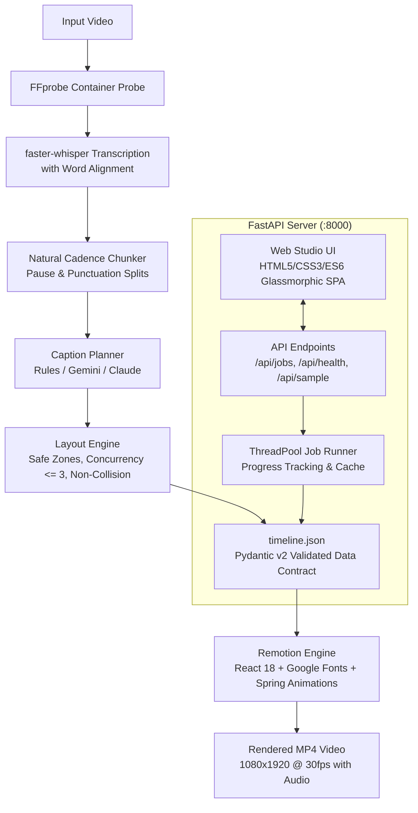

# 🎬 Dynamic Captions Studio

> **Transform vertical videos with multi-style, animated, overlapping, and collision-free dynamic captions** inspired by top creator content (Hormozi, MrBeast, modern reels).

[](https://www.python.org/)
[](https://www.remotion.dev/)
[](https://fastapi.tiangolo.com/)
[](LICENSE)

---

## 🌟 Overview

**Dynamic Captions Studio** takes any uploaded video (portrait 9:16 or landscape) and renders synchronized, animated captions with:
- **8 Distinct Caption Styles**: 3D gradient extruded titles, frosted & neon glow cards, word-by-word highlighted pills, editorial serif titles, numbered badges, handwritten asides, arched letter tracking, and dynamic stickers.
- **Overlapping Multi-Track Layout**: Multiple simultaneous captions (e.g. continuous lower speech tracking while upper/center highlight cards pop in) with strict zone-collision avoidance.
- **Dynamic Graphics & Doodles**: Auto-detected emojis, vector icons (Lucide), and animated SVG draw-on path doodles (arrows, ellipses, underlines, sparkles).
- **Pluggable Styling Intelligence**: Rule-based heuristic planner (zero API keys required) or LLM-augmented planning via Google Gemini or Anthropic Claude.
- **Premium Creator Web Studio**: Dark-mode glassmorphic single-page studio with real-time progress tracking, inline 9:16 vertical video player, interactive style previews, and timeline JSON inspector.

---

## 🏗️ Architecture



---

## 🚀 Quickstart Guide

### 1. Prerequisites
- **Python**: 3.10+ (Python 3.11 recommended for CTranslate2 wheel compatibility)
- **Node.js**: 20.x+ & npm
- **FFmpeg & FFprobe**: Available on system `PATH`
- **Git**: Installed

### 2. Environment Setup

```bash
# Clone the repository
git clone https://github.com/your-repo/dynamic-captions-studio.git
cd dynamic-captions-studio

# Create Python virtual environment
py -3.11 -m venv .venv

# Activate virtual environment
# Windows (PowerShell):
.venv\Scripts\Activate.ps1
# macOS / Linux:
source .venv/bin/activate

# Install Python backend dependencies
pip install -r requirements.txt

# Install Remotion React dependencies
cd remotion
npm ci
cd ..
```

### 3. Environment Variables (Optional for LLM)

Copy `.env.example` to `.env`:
```bash
cp .env.example .env
```

Set `LLM_PROVIDER`:
- `LLM_PROVIDER=none`: Default rule-based heuristic planner (no API keys required, works 100% offline).
- `LLM_PROVIDER=gemini`: Set `GEMINI_API_KEY=your_key` for Google Gemini planning.
- `LLM_PROVIDER=anthropic`: Set `ANTHROPIC_API_KEY=your_key` for Claude planning.

---

## 💻 Command-Line Interface (CLI)

The CLI supports complete end-to-end rendering directly from the terminal.

### Canonical Render Command
```bash
python -m backend.cli samples/input.mp4 -o out/final.mp4
```

### CLI Options & Flags

| Flag | Type | Description | Default |
| :--- | :--- | :--- | :--- |
| `input` | `str` | Path to source video file | *Required* |
| `-o`, `--output` | `str` | Output MP4 destination | `out/final.mp4` |
| `--preset`, `--style-preset` | `choice` | `bold_creator`, `calm_serif`, `minimal_pill` | `bold_creator` |
| `--llm` | `choice` | `none`, `gemini`, `anthropic` | Environment or `none` |
| `--language` | `str` | Spoken language code (e.g. `en`, `es`, `fr`, `auto`) | `en` |
| `--whisper-model` | `choice` | `tiny`, `base`, `small`, `medium` | `small` |
| `--concurrency` | `int` | Remotion render worker threads | Auto |
| `--draft` | `flag` | Fast preview at half resolution (scale 0.5) | `False` |
| `--start` / `--end` | `float` | Start/end timestamp in seconds to render a clip | Full video |
| `--frames` | `str` | Remotion frame range (e.g. `0-150`) | Full duration |
| `--timeline-out` | `str` | Save generated `timeline.json` to disk | None |

### Examples

**Fast Draft Preview (0s to 5s at half resolution):**
```bash
python -m backend.cli samples/input.mp4 -o out/draft.mp4 --draft --start 0 --end 5
```

**Editorial Calm Serif Style:**
```bash
python -m backend.cli samples/input.mp4 -o out/calm.mp4 --preset calm_serif
```

**Minimalist Word-by-Word Pill Track:**
```bash
python -m backend.cli samples/input.mp4 -o out/minimal.mp4 --preset minimal_pill
```

---

## 🌐 Web Studio UI

Start the local web server:
```bash
uvicorn backend.api.app:app --host 127.0.0.1 --port 8000
```
Open your browser at **[http://127.0.0.1:8000/](http://127.0.0.1:8000/)**.

### Web Studio Features
1. **Drag-and-Drop Video Upload**: Instant container validation and probe preview.
2. **One-Click Synthetic Sample**: Preloaded talking clip (`samples/synthetic.mp4`) for immediate testing without personal media.
3. **Preset Selector**: Select between **Bold Creator**, **Calm Serif**, or **Minimal Pill**.
4. **Live Pipeline Progress**: Real-time checklist tracking probing, transcription, phrasing, planning, and Remotion rendering.
5. **Interactive Video Player**: Native 9:16 vertical video player with controls.
6. **Timeline Event Inspector**: Inspect active styles, zone allocations, attached stickers, and word ranges.
7. **Collapsible JSON Viewer**: View or copy the standardized `timeline.json` data payload.

---

## 🎨 Style Library & Zones

All styles are implemented as modular React components in `remotion/src/styles/` adhering strictly to vertical safe margins (avoiding platform UI overlaps).

| Style ID | Visual Aesthetic | Font Family | Default Zone | Decorations |
| :--- | :--- | :--- | :--- | :--- |
| `title3d` | 3D extruded gradient titles with drop shadow | Montserrat 900 | Center | Sparkles, Stars |
| `blob_card` | Rounded pill cards (glow neon or frosted glass) | Inter 800 | Center / Upper | Drop-shadow glow |
| `pill_word` | Word-by-word synchronized highlighting | Montserrat 800 | Lower | Active word pill |
| `serif_title` | High-contrast editorial headlines | Playfair Display 900 | Upper / Center | Ellipse, Underline |
| `numbered_point` | Badged step count list item | Montserrat / Playfair | Upper | Curved underline |
| `handwritten` | Casual human note/aside with arrow | Caveat 700 | Upper | Animated arrow |
| `arc_letters` | Kinetic curved arc letter tracking | Montserrat 900 | Center | Subtle arc bend |
| `sticker` | Floating animated emoji / vector icon badges | Lucide / Noto | Center / Free | Pop-in scale bounce |

### Layout Zones & Constraints
- **Upper Zone (`top: 20%`)**: Reserved for hook headlines, step counts, and callouts.
- **Center Zone (`top: 48%`)**: Reserved for high-impact 3D titles, stickers, and definition cards.
- **Lower Zone (`top: 74%`)**: Reserved for continuous word-by-word speech tracking.
- **Collision Invariants**: Maximum 3 concurrent active captions; zero temporal overlap within the same zone.

---

## 🐳 Docker Deployment

A production-ready `Dockerfile` bundling Python 3.11, Node.js 20, and FFmpeg is included:

```bash
# Build the Docker image
docker build -t dynamic-captions-studio .

# Run the container
docker run -p 8000:8000 dynamic-captions-studio
```
The studio will be available at `http://localhost:8000/`.

---

## 🧪 Testing

Run the automated test suite covering chunking, transcription, layout invariants, style components, API routes, and hardening:

```bash
pytest -v
```

All 47 tests pass automatically across Windows, macOS, and Linux.

---

## 📁 Repository Map

```
dynamic-captions-studio/
├── backend/
│   ├── api/             # FastAPI app, endpoints, background runner
│   ├── pipeline/        # Probe, Transcribe, Chunk, Planner, Layout, Render
│   ├── schemas/         # Pydantic v2 timeline schema & JSON export
│   └── tests/           # Pytest integration & unit test suite
├── remotion/
│   ├── src/
│   │   ├── CaptionedVideo/  # Main composition & zone container
│   │   ├── styles/          # 8 distinct caption style components
│   │   ├── decorations/     # SVG doodles & Lucide icon / emoji stickers
│   │   └── anim/            # Deterministic Remotion spring helpers
│   └── public/              # Bundled assets and fonts
├── frontend/            # Glassmorphic single-page web studio
├── samples/             # Sample input videos
├── out/                 # Output renders, gallery stills, and timeline.json
├── docs/                # Architecture specifications, build plan, style guide
├── Dockerfile           # Production container configuration
├── PROGRESS.md          # Phased build tracker
└── README.md            # Project documentation
```
