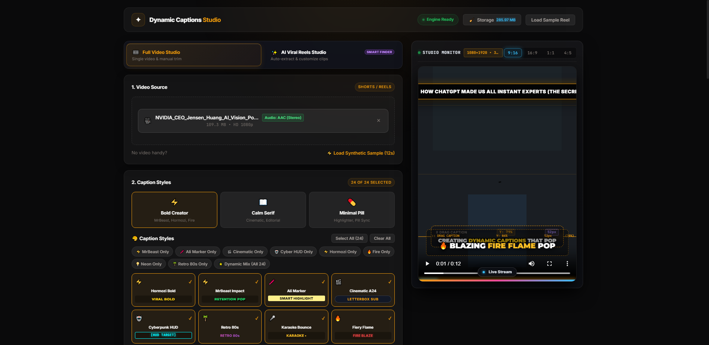
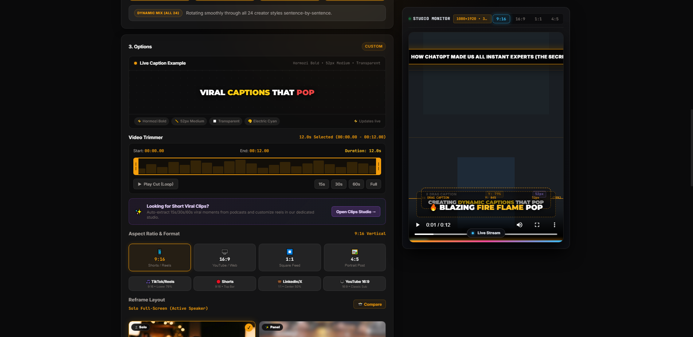
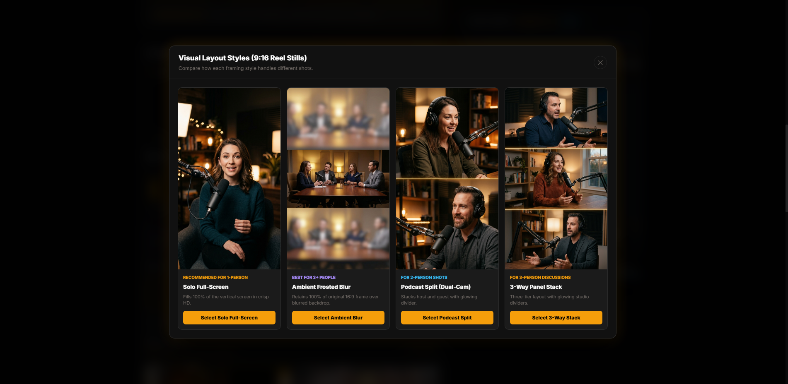
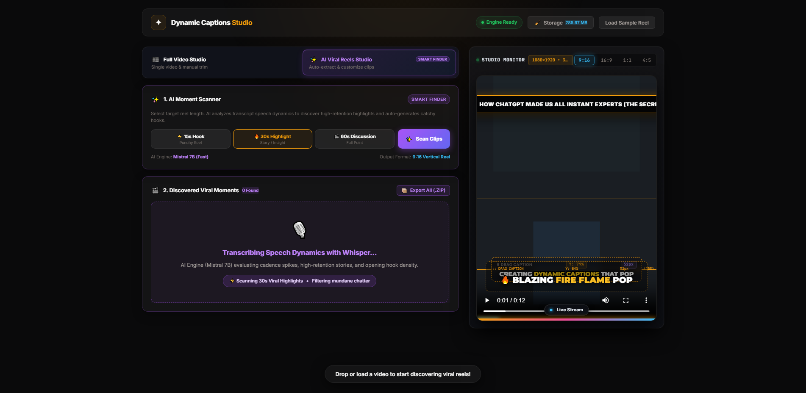
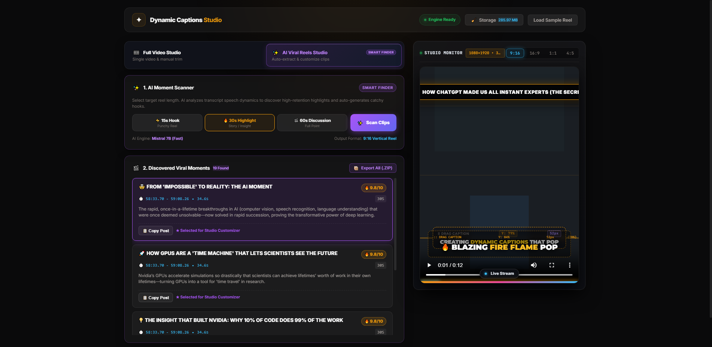
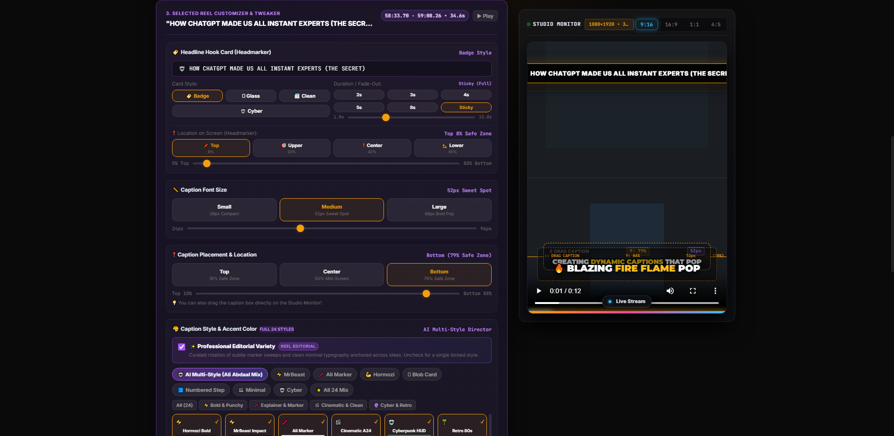
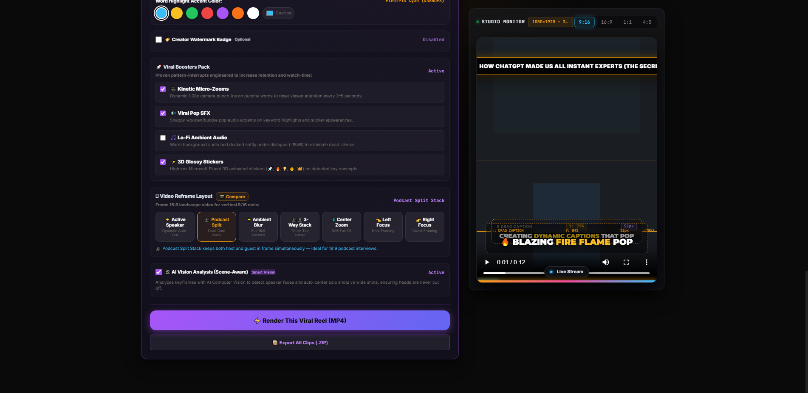
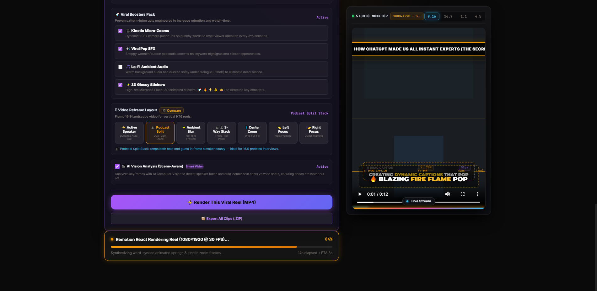

# 📸 VibeCut AI — Complete Frontend Screens & Prediction Showcase

> **Comprehensive Visual Guide & System Architecture Walkthrough**  
> Every screen of the **VibeCut AI (Dynamic Captions Studio)** frontend is documented below with high-resolution captures, UI component breakdowns, and explanations of how the AI prediction and computer vision reframing pipeline operates.

---

## 📑 Table of Contents
1. [Screen 1: Video Ingestion & Stream Multiplexer](#1-video-ingestion--stream-multiplexer)
2. [Screen 2: Dual-Handle Trimmer & Multi-Platform Aspect Ratios](#2-dual-handle-trimmer--multi-platform-aspect-ratios)
3. [Screen 3: Computer Vision 9:16 Reframe Layout Modal](#3-computer-vision-916-reframe-layout-modal)
4. [Screen 4: AI Moment Scanner & Prediction Pipeline](#4-ai-moment-scanner--prediction-pipeline)
5. [Screen 5: Discovered Viral Moments & Virality Predictions](#5-discovered-viral-moments--virality-predictions)
6. [Screen 6: Selected Reel Customizer & Headmarker Studio](#6-selected-reel-customizer--headmarker-studio)
7. [Screen 7: 24 Signature Styles Pool & Viral Boosters Pack](#7-24-signature-styles-pool--viral-boosters-pack)
8. [Screen 8: Live Studio Monitor & Speaker Tracking](#8-live-studio-monitor--speaker-tracking)
9. [Screen 9: Remotion React Rendering & Batch Export](#9-remotion-react-rendering--batch-export)

---

## 1. Video Ingestion & Stream Multiplexer

### Key Capabilities & Prediction Flow:
- **Automatic Audio & Video Stream Container Probe**: Automatically analyzes container streams using `ffprobe`.
- **Silent / YouTube DASH Stream Detection**: Detects if an uploaded 1080p/4K YouTube video lacks audio, dynamically displaying an audio attachment utility with zero re-encoding loss.
- **Audio Codec Verification**: Badges valid stereo tracks (e.g., `Audio: AAC (Stereo)`) and displays file size and resolution.
- **Aspect Ratio & Platform Target Badging**: Identifies horizontal landscape (16:9) and targets vertical Shorts/Reels (9:16).
- **Embedded Studio Monitor**: Shows the live framing preview before transcription starts.

---

## 2. Dual-Handle Trimmer & Multi-Platform Aspect Ratios

### Key Capabilities & Prediction Flow:
- **CapCut-Style Waveform Visualizer**: Renders volume peaks and pauses across the timeline, allowing creators to isolate high-energy segments.
- **Draggable Precision Handles**: Draggable left and right yellow timeline handles with live timestamp readouts down to the millisecond (`00:00.00 - 00:12.00`).
- **Quick-Cut Jump Buttons**: 1-click presets for `15s`, `30s`, `60s`, or `Full` video lengths.
- **Target Platform Presets**:
  - `📱 9:16 Vertical` — TikTok, Instagram Reels, YouTube Shorts (Lower 79% Safe Zone)
  - `🖥️ 16:9 Landscape` — YouTube Desktop, Web Embeds (Classic Subtitle Placement)
  - `⏹️ 1:1 Square Feed` — LinkedIn, Facebook Feeds (Center 50% Safe Zone)
  - `🖼️ 4:5 Portrait Post` — Instagram Grid Posts

---

## 3. Computer Vision 9:16 Reframe Layout Modal

### Key Capabilities & Prediction Flow:
- **YuNet Neural Network Speaker Tracking**: Analyzes speaker face coordinates to center faces in vertical framing without awkward crops.
- **Visual Layout Stills Comparison**:
  1. **Solo Full-Screen (Active Speaker)**: Automatically detects speaker transitions and crops directly to whoever is voicing dialogue in full vertical HD.
  2. **Ambient Frosted Blur (`blur_fit`)**: Retains 100% of the original 16:9 landscape framing, layered over an animated, blurred 9:16 background.
  3. **Podcast Split (Dual-Cam Stack)**: Divides the vertical frame into two equal halves (host on top, guest on bottom) with a glowing amber separator line.
  4. **3-Way Panel Stack**: Divides the vertical canvas into three panels for multi-guest roundtable discussions.

---

## 4. AI Moment Scanner & Prediction Pipeline

### Key Capabilities & Prediction Flow:
- **AI Moment Scanner (`#tabClipsStudio`)**: Switch between full manual trim and intelligent clip extraction with a single click.
- **Speech Dynamics Analysis**:
  - `🎙️ Whisper Transcription`: Generates word-level timestamps with `faster-whisper` (`int8` quantized).
  - `⚡ Cadence & Pause Splitting`: Evaluates speech energy, silence boundaries, and natural speech pauses.
  - `🧠 Viral Hook Evaluation`: The LLM engine (**Mistral 7B** / **Gemini 2.5 Flash** / **Rule-Based Heuristics**) scans dialogue for breakthrough lessons, heated counterpoints, and memorable one-liners.
  - Mundane chatter, introductions, and filler words are automatically filtered out.

---

## 5. Discovered Viral Moments & Virality Predictions

### Key Capabilities & Prediction Flow:
- **Curated Viral Highlight Feed**: Displays predicted high-retention clips (e.g. `22 Found` from a 1-hour talk).
- **Virality Scoring Engine (7.0 - 10.0)**:
  - `🔥 9.9/10` & `🔥 9.8/10` virality badges based on hook strength, speech pacing, and conceptual novelty.
- **Automatic Social Media Post Generator**:
  - Click **"📋 Copy Post"** to copy pre-formatted viral hooks, descriptions, and hashtags tailored for TikTok, Reels, and Shorts.
- **Instant Studio Selection**: Clicking any card loads its exact time boundaries and generated headline directly into the Studio Monitor and Customizer.

---

## 6. Selected Reel Customizer & Headmarker Studio

### Key Capabilities & Prediction Flow:
- **Top Headline Hook Card (Headmarker)**:
  - Attention-grabbing sticky card rendered at the top of the video to maximize 3-second hook retention.
  - **4 Visual Themes**: `🏷️ Badge` (Amber Pill), `🫧 Glass` (Apple Frosted Blur), `📰 Clean` (High-Contrast B&W), `🤖 Cyber` (Neon HUD Brackets).
  - **Duration & Fade-Out Controls**: `2s`, `3s`, `4s`, `5s`, `8s`, or `📌 Sticky` (Full Video duration).
- **Safe-Zone Headmarker Positioning**:
  - `📌 Top (8%)`, `🎯 Upper (22%)`, `📍 Center (42%)`, `📐 Lower (65%)` presets plus granular 5%–80% slider.
- **Caption Font Size**:
  - `Small (38px)`, `Medium (52px Sweet Spot)`, `Large (68px Bold Pop)` with a 24px–96px slider.
- **Caption Safe-Zone Placement**:
  - Drag the caption box directly on the Studio Monitor or select `Top (18%)`, `Center (50%)`, or `Bottom (79%)`.

---

## 7. 24 Signature Styles Pool & Viral Boosters Pack

### Key Capabilities & Prediction Flow:
- **Ali Abdaal Professional Editorial Variety**:
  - Rotates between subtle marker sweeps, clean minimal typography, and quote editorial cards every 3–4 sentences to prevent aesthetic fatigue.
- **24 Signature Caption Styles**:
  - `⚡ Hormozi Bold`, `💥 MrBeast Impact`, `🖍️ Ali Highlighter Marker`, `🎤 Karaoke Bounce`, `💊 Minimal Pill`, `🔥 Fire Burn`, `🤖 Cyber HUD`, `🎬 Cinematic Minimal`, `✨ Neon Glow`, `⚡ Glitch Kinetic`, and 14 more.
- **Word Highlight Accent Palette**:
  - Electric Cyan (`#38BDF8`), Cyber Gold (`#FBBF24`), Neon Green (`#22C55E`), Crimson Rose (`#EF4444`), Purple Pop (`#A855F7`), Sunset Orange (`#F97316`), Clean White, or Custom Hex Picker.
- **Viral Boosters Retention Pack**:
  - `🎥 Kinetic Micro-Zooms`: Dynamic 1.08x camera punch-ins on punchy words to reset viewer attention every 3–5 seconds.
  - `🔊 Viral Pop SFX`: Snappy wooden/bubble pop audio accents on keyword highlights.
  - `🎵 Lo-Fi Ambient Audio`: Subtle background bed ducked softly under dialogue (-18dB).
  - `✨ 3D Glossy Stickers`: High-res Microsoft Fluent 3D animated stickers (`🚀`, `🔥`, `💡`, `💰`, `👑`).
  - `🎬 AI Vision Analysis (Scene-Aware)`: Scene-aware face centering to ensure speaker heads are never cropped.

---

## 8. Live Studio Monitor & Speaker Tracking

### Key Capabilities & Prediction Flow:
- **Real-Time 9:16 Live Stream Monitor**: Shows exact layout framing, camera zoom, headmarker card, active caption box, and bottom gradient progress bar.
- **Interactive Drag-to-Position**: Creators can click and drag the caption bounding box directly on the phone canvas with live Y% safe-zone coordinate telemetry.
- **Framing Status Pill**: Indicates `Solo Full-Screen (Active Speaker) Preview` or `Podcast Split Stack`.
- **Active-Window Pagination Shield**: Restricts text to 3–5 words on screen at any moment to eliminate vertical text walls.

---

## 9. Remotion React Rendering & Batch Export

### Key Capabilities & Prediction Flow:
- **React 18 + Remotion 4.0 Engine**: Renders high-definition vertical MP4 videos (`1080x1920 @ 30 FPS`) with hardware-accelerated Chromium composition.
- **Physics-Based Spring Animations**: Fluid word pops, scale bounces, marker sweeps, and particle flairs.
- **Real-Time Progress Tracking**:
  - Live progress percentage (`84%`), active synthesis stage description, and elapsed/remaining time estimates.
- **Batch Export (.ZIP)**:
  - 1-click export of all discovered viral clips into a organized `.zip` bundle with pre-rendered MP4s and post caption text files.

---

## 📂 Screenshot Asset Index

All high-resolution original PNG screenshots are saved in `docs/screenshots/`:

| File | Resolution | Description |
| :--- | :--- | :--- |
| [`01_full_studio_ingestion.png`](file:///c:/Users/David/Downloads/dynamic-captions-studio/dynamic-captions-studio/docs/screenshots/01_full_studio_ingestion.png) | 1920 × 1080 | Video ingestion, AAC stream detection, source details, and caption style presets |
| [`02_full_studio_trimmer_and_reframe.png`](file:///c:/Users/David/Downloads/dynamic-captions-studio/dynamic-captions-studio/docs/screenshots/02_full_studio_trimmer_and_reframe.png) | 1920 × 1080 | Waveform trimmer, start/end timestamps, aspect ratios, and platform targets |
| [`03_reframe_layout_comparison_modal.png`](file:///c:/Users/David/Downloads/dynamic-captions-studio/dynamic-captions-studio/docs/screenshots/03_reframe_layout_comparison_modal.png) | 1920 × 1080 | Visual 4-layout modal (Solo Full-Screen, Ambient Blur, Podcast Split, 3-Way Stack) |
| [`04_ai_moment_scanner_prediction_pipeline.png`](file:///c:/Users/David/Downloads/dynamic-captions-studio/dynamic-captions-studio/docs/screenshots/04_ai_moment_scanner_prediction_pipeline.png) | 1920 × 1080 | AI Moment Scanner live prediction state with Whisper and Mistral 7B dynamics |
| [`05_ai_discovered_viral_moments.png`](file:///c:/Users/David/Downloads/dynamic-captions-studio/dynamic-captions-studio/docs/screenshots/05_ai_discovered_viral_moments.png) | 1920 × 1080 | Predicted viral highlights with virality scores (🔥 9.8/10) and social publishing copy |
| [`06_reel_customizer_headmarker.png`](file:///c:/Users/David/Downloads/dynamic-captions-studio/dynamic-captions-studio/docs/screenshots/06_reel_customizer_headmarker.png) | 1920 × 1080 | Reel Customizer, Headmarker Hook Card, duration chips, safe-zone positioning slider |
| [`07_caption_styles_pool_and_boosters.png`](file:///c:/Users/David/Downloads/dynamic-captions-studio/dynamic-captions-studio/docs/screenshots/07_caption_styles_pool_and_boosters.png) | 1920 × 1080 | 24 Signature Styles pool, Ali Abdaal editorial mode, and Viral Boosters pack |
| [`08_studio_monitor_live_reel_preview.png`](file:///c:/Users/David/Downloads/dynamic-captions-studio/dynamic-captions-studio/docs/screenshots/08_studio_monitor_live_reel_preview.png) | 1920 × 1080 | Studio Monitor closeup showing speaker tracking, hook badge, and kinetic pop caption |
| [`09_rendering_pipeline_progress.png`](file:///c:/Users/David/Downloads/dynamic-captions-studio/dynamic-captions-studio/docs/screenshots/09_rendering_pipeline_progress.png) | 1920 × 1080 | Real-time Remotion rendering progress bar (84%) and batch export |
